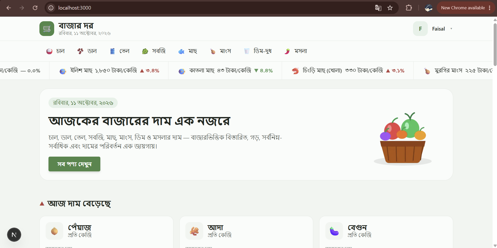

<h1 align="center">Bazar Dor (বাজার দর) 🛒</h1>

<p align="center">
  A modern, responsive web application built to help users track the daily market prices of essential commodities in Bangladesh.
  <br />
  <a href="https://bazar-dor-eight-beta.vercel.app"><strong>View Live Demo »</strong></a>
</p>

<div align="center">
  
  
  
  
  
</div>

<br />

## 📸 Overview



## ✨ Key Features

- **Live Price Ticker:** A continuous marquee in the navbar displaying the latest prices and trends.
- **Dynamic Categories & Sorting:** Browse products by categories with built-in price sorting functionality.
- **Market Price Comparison:** View detailed minimum, maximum, and average prices across different markets in Bangladesh.
- **Authentication System:** Secure email/password login and social logins (Google & GitHub) powered by BetterAuth.
- **Protected Routes:** Product details and user profiles are restricted to authenticated users.
- **Responsive Design:** Optimized layout scaling perfectly across mobile, tablet, and desktop devices.

## 🛠️ Technology Stack

| Category | Technology |
| :--- | :--- |
| **Framework** | Next.js 16 (App Router), React 19 |
| **Styling** | Tailwind CSS, DaisyUI |
| **Authentication** | BetterAuth (Email, Google, GitHub) |
| **Database** | MongoDB Atlas (Native Adapter) |
| **Deployment** | Vercel |

## 📦 Installation & Setup

**1. Clone the repository**
```bash
git clone https://github.com/Md-Rifat-Al-Faisal/bazar-dor.git
cd bazar-dor
```

**2. Install dependencies**
```bash
npm install
```

**3. Set up Environment Variables**
Create a `.env` file in the root directory and add the following:
```env
MONGODB_URI=your_mongodb_connection_string
BETTER_AUTH_SECRET=your_secret_key
BETTER_AUTH_URL=http://localhost:3000
GOOGLE_CLIENT_ID=your_google_client_id
GOOGLE_CLIENT_SECRET=your_google_client_secret
GITHUB_CLIENT_ID=your_github_client_id
GITHUB_CLIENT_SECRET=your_github_client_secret
```

**4. Run the development server**
```bash
npm run dev
```
Open [http://localhost:3000](http://localhost:3000) to view it in your browser.